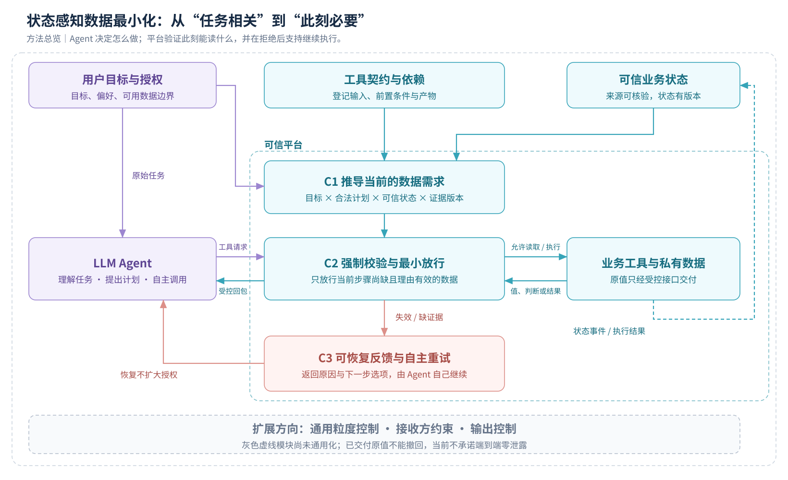

# 状态感知 Agent 数据最小化：方法、代码与实验

更新：**2026-11-24**。研究目标：在原授权内，结合可信业务状态与工具依赖，验证“这个步骤此刻为什么需要这些数据”，并在理由失效后让 Agent 自主恢复。

## 从这里开始

- **[当前实验、代码、效果与进展总览](docs/CURRENT_PROGRESS.md)**
- **[完整 idea、三项贡献与方法设计](docs/PAPER_IDEA.md)**
- [当前材料复现与离线复核](docs/CURRENT_REPRODUCIBILITY.md)
- [全部实验索引及证据等级](docs/EXPERIMENTS.md)



[四轮强基线对照、论文结论与投稿前验证](docs/STRONG_BASELINE_FOLLOWUP.md)

## 当前最有力的结果

新120个合成任务、60个状态配对，MaaS qwen3.8-flash，三组各重复三次，共1080次尝试。规则、授权、确认、恢复、原生工具和预算跑前冻结。

| 方案 | 业务完成 | 最终未用字段累计 | 工具调用 | 模型调用 | 确认 | 可见文字泄露轨迹 |
|---|---:|---:|---:|---:|---:|---:|
| 事前给齐 | 359/360 | 1049 | 2775 | 3134 | 139 | 1 |
| 自行按需 | 359/360 | 144 | 3487 | 3840 | 141 | 0 |
| 后端按状态校验 | 359/360 | 0 | 3446 | 3806 | 141 | 1 |

**可说：**动态任务上的不必要取数减少，业务完成率保持较高。自行按需过期字段144，后端0；120次实际拦截中119条完成。**不能说：**零最终回答泄露、稳定节省调用、全面优于完整AirGapAgent或对所有模型无损。

字段按每次尝试内去重后相加，不是真实用户数。业务完成不等于正常最终文字收尾，后者分别354/360、352/360、355/360。事前组动态事件只触发108/120，另两组120/120；三组动态子集不能作完全相同外部状态暴露的归因。详见[完整报告](necessity-three-arm-holdout/REPORT.md)和[当前总览](docs/CURRENT_PROGRESS.md)。

## 代码与原始材料

- [核心必要性/证据/交付机制](necessity_v2/core.py)
- [当前新任务运行器与主计分](necessity_holdout.py)
- [原生工具协议适配](necessity_native_retest.py)
- [任务](necessity-three-arm-holdout/tasks.json)、[逐任务评分](necessity-three-arm-holdout/metrics.json)、[配对分析](necessity-three-arm-holdout/analysis.json)
- [报告与协议](necessity-three-arm-holdout/REPORT.md)、[冻结指纹](necessity-three-arm-holdout/freeze.json)、[失败/泄露定位](necessity-three-arm-holdout/failure-and-leak-diagnostics.json)
- [完整后续轨迹压缩包清单](artifacts/2026-11-23/ARCHIVE_MANIFEST.json)

后续原始缓存体积较大，采用无损压缩保留。报告和任务可直接在线读；完整重放先解包：

```bash
python3 scripts/extract_research_archives.py --all
python3 scripts/verify_current_progress.py --replay
python3 -m unittest discover -s tests -v
```

这些命令不调用模型API。单独做元数据/冻结检查可运行 `python3 scripts/verify_current_progress.py`；发布内容及压缩包秘密扫描为 `python3 scripts/secret_scan.py`。详细行为、异常前缀、预算与重跑限制见[当前复现指南](docs/CURRENT_REPRODUCIBILITY.md)。

## 研究与历史边界

当前主线是动态必要性、交付重验证和不扩权恢复。字段裁剪之外的通用精度、接收方/输出控制、自然语言可靠授权编译、句柄强替代及真实服务并发仍需研究。

更早本地Qwen3-1.7B-4bit实验有明显成功率代价；普通任务里强模型自行按需已经零多读。历史结果、失败和混杂实验全部保留，不与新题混算。[2026-11-19完整快照说明](docs/history/README-20261119-SNAPSHOT.md)、[历史复现指南](docs/REPRODUCIBILITY.md)。

事前给齐只是消融基线；另有含可信最小化、隔离和用户升级的[AirGap架构适配实验](airgap-escalation-state-study/REPORT.md)，也不是原论文精确复现。既有AirGapAgent和工具权限/信息流工作不能被简化掉；定位见[研究方案](docs/PAPER_IDEA.md)。

## 数据、凭据与许可

全部业务资料为合成数据，操作在模拟后端完成。模型权重、API密钥、认证头、内部端点和私有配置不提交。完整合成值匹配不覆盖部分值、语义推断或隐藏推理。

上游AirGapAgent-R数据与派生材料按[第三方声明](THIRD_PARTY_NOTICES.md)标注；原有许可状态保留，本次未替作者选择新的原创代码许可证。当前发布字节见 `PUBLICATION_MANIFEST.json`；历史执行指纹仍按各阶段说明解释。

发布时完成49项机制/计分测试、7项归档辅助安全检查、四阶段全量缓存重放与独立重算。[本次复核记录](artifacts/checks-20261124/verification-summary.json)。
