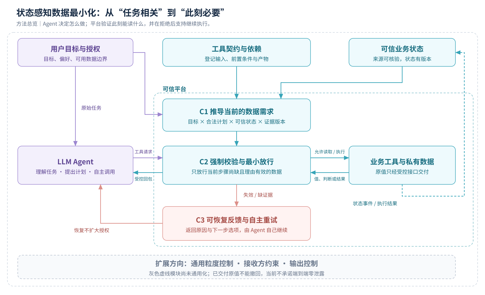
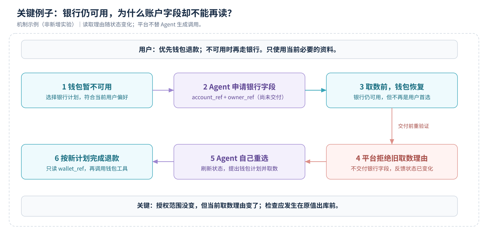
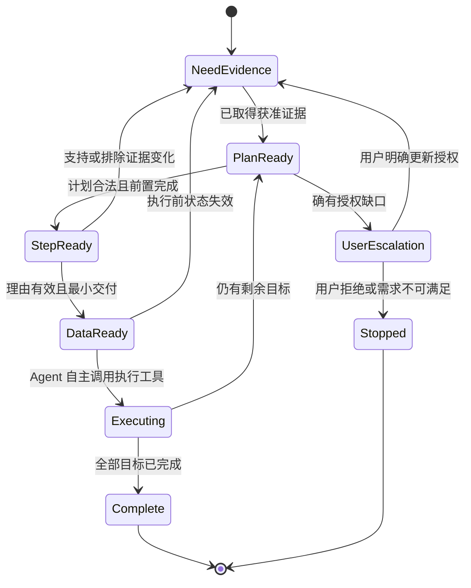

# 论文思路定稿草案：面向工具调用 Agent 的状态感知数据最小化

更新于 2026-11-24。本研究方案优先固定问题、机制与贡献边界；本次仅扩充设计文档，不新增模型实验。图中的实线模块对应已有原型机制，灰色虚线模块表示拟扩展能力。“贡献”是论文组织建议，不是已完成的新颖性认证。

## 阅读导航

- [问题与三项贡献](#三项贡献如何组织)
- [必要性对象与交付约束](#把机制写清楚接口与约束)
- [信任边界](#信任边界与威胁模型)
- [未知条件与查询选择](#未知条件多合法计划与查询选择)
- [句柄等替代交付方式](#为什么不全程使用句柄避免模型看到原值)
- [目标设计伪代码](#机制流程与伪代码)
- [恢复状态机](#恢复状态机与拒绝原因)
- [能力边界与相关工作](#哪些已落地哪些先不要写成贡献完成态)
- [研究推进顺序](#研究推进顺序与完成标准)

## 一句话主张

**把“某字段与任务相关”推进到“当前合法计划的这个步骤，此刻有充分理由读取这个字段”：由模型提出任务计划和工具请求，由可信平台在原值出库前验证，并在理由失效后提供可继续执行的反馈。**

平台不是替 Agent 决策的脚本。Agent 仍自行查询、选计划、取值和执行；平台负责把原始授权、工具契约、可信状态和数据需求连接起来，约束实际交付。

建议中文题目：**面向工具调用 Agent 的状态感知数据最小化**。

建议英文题目：**State-Aware Data Minimization for Tool-Using Agents**。



副标题可用：模型与规则融合的必要性推导、强制放行与可恢复反馈。

## 给第一次接触这个课题的人

Agent 像一个替用户办事的助理。用户允许它办理退款，不代表它应先把钱包、银行卡、身份资料全部读一遍。甚至“刚才确实需要”的资料，也可能因为业务状态改变而在现在不再需要。

我们的目标是在 Agent 与业务数据之间建立一层可信执行机制：模型继续负责理解和行动，平台负责验证每次交付数据的理由。平台既不能因为模型说“我需要”就放行，也不能简单拒绝后把任务留在那里。它需要说明缺什么证据、哪条理由过期、哪些步骤可以继续，且恢复过程不能默默扩大用户授权。

论文研究对象是**必要性的生命周期**：生成理由、约束交付、发现失效、恢复执行。长期可以发展为数据访问及使用最小化平台；当前论文先聚焦结构化工具的数据访问环节，明确把输出隐私、任意接收方约束等列为独立扩展。

### 研究问题

- **RQ1：如何定义必要性？** 在有多个合法计划、部分状态未知时，怎样区分获准决策信息、执行原值和没有充分理由的额外读取？
- **RQ2：如何落实约束？** 怎样把同一份必要性理由连接到实际工具数据出口，并在状态变化后重新检查？
- **RQ3：如何保持可用？** 怎样在拒绝或补证据后继续完成原任务，同时保持授权边界、避免重复副作用和不必要的用户打扰？

这三个问题需要一套一致机制。单独使用字段过滤、签名令牌、规则引擎或重试提示，都不足以说明研究增量。

## 为什么需要这个问题

用户说：“优先钱包退款；钱包不可用再走银行。”

银行退款的账户引用和所有者引用当然与这个退款任务有关。但它们不一定现在就该进入模型：

1. 钱包不可用时，银行计划成立，申请账户字段有理由。
2. 读取执行前钱包恢复，银行仍可用，但不再符合用户的当前优先顺序。
3. 旧的银行取数理由已经失效。平台应先阻止账户字段交付，再让 Agent 刷新状态、重选钱包并完成退款。

**新问题不只是“敏感字段要不要屏蔽”，还包括“随着任务推进，读取理由何时成立、何时失效，以及被拒绝后怎么继续”。** 合法读取过的值无法通过撤销权限从模型上下文中收回，因此检查必须尽量发生在交付之前。

图的可编辑源文件：[框架 SVG](assets/paper-framework/framework.svg)、[退款流程 SVG](assets/paper-framework/refund-flow.svg)。例子用于解释机制，不是一条新增实验结果。



## 三项贡献如何组织

### C1：面向任务执行的动态数据需求表示与必要性推导

将目标、授权、候选合法计划、当前步骤、数据需求和支持证据联系起来，而不是按任务名预先给定一份永远不变的字段清单。

具体要回答：

- 当前有哪些可完成用户目标的合法计划？哪些前置条件仍未知？
- 哪些数据是选路线所需的获准决策信息，哪些是执行当前步骤所需的原值？
- 是否存在用户更偏好的、尚未被可信证据排除的计划？
- 状态变化后，先前的取数理由是否仍成立？需要同时检查所选路线的支持证据和排除其他优先路线的证据。

多个计划都合法时，不能把不同于参考路线的所有字段都判成过度取数。首先满足授权与用户效用要求；只有用户明确提出隐私偏好时，才在相应效用条件下比较披露成本。字段数量只是成本代理，不等于实际隐私损失。

**候选研究增量**：把必要性表示为随证据变化、可检查和可撤销的执行理由，而非单次语义分类标签。图、计划枚举、证据版本和签名本身都不是独立的新颖算法。

### C2：模型提出请求、规则强制执行的最小放行机制

模型理解自然语言并提出候选计划或查询；平台根据可信规则验证这些提案。模型说“为了完成任务需要更多数据”，不能自动扩大权限。

每次交付原值前检查：目标及资源是否匹配；步骤是否已经启用；字段是否属于当前步骤且尚缺；证据和数据版本是否有效。当前原型使用基础工具契约组合计划、合并共享依赖，并在受控连接器读取时校验。

这里的关键不是“在后端多写一个 if”，而是**让同一个读取理由贯穿计划推导、实际取数和状态变化后的重验证**。在支持的固定判断接口中，可返回获准的布尔结果，避免把精确数值交给模型；这些结果仍是信息披露，后端读取仍需计数。

**候选研究增量**：语义灵活性由模型承担，授权和真实字段交付由平台约束；把动态必要性落实到数据出口。可信连接器、工具契约及完整拦截是必要前提，不是任意 Agent 上自动成立的保证。

### C3：不扩大授权的可恢复反馈闭环

拒绝不能只返回“权限不足”。应区分缺少证据、理由过期、步骤未启用、已有可复用值、真正缺少授权等原因，并返回不含未授权原值的下一步信息。

- 理由过期：提示刷新状态并重新提出计划。
- 数据已持有：提示复用当前有效值，避免重复取数。
- 前置步骤未完成：指出所缺的前置产物，让模型自行继续调用。
- 信息不足：允许调用登记且获准的判断接口；判断接口不能被任意改阈值来套取原值。
- 确实超出授权：保持拒绝；只有明确的用户授权变更才能扩大范围。

Agent 自己生成重试的工具名与参数。平台不补执行，不因“恢复任务”而越权，也不让第三方文字改变用户目标。

**候选研究增量**：把安全拒绝设计为任务仍能继续的交互协议，并明确恢复必须保持哪些约束。通用重试提示不是单独创新；“少读但完成不了”与“恢复时越权”这两类失败，才是闭环设计需要共同解决的问题。

## 可放进引言的贡献表述（候选版本）

1. **动态必要性建模。** 我们研究多合法计划与变化业务状态下的数据需求，将读取必要性表示为关联目标、执行步骤和可信证据版本的理由，并区分获准决策信息与执行原值。
2. **模型与规则协作的运行时交付机制。** 我们构建从工具契约推导需求、在实际读取时强制校验理由的机制，使模型保持自主工具调用能力，同时将实际字段交付约束在当前有效步骤内。
3. **保持授权的恢复协议。** 我们将过期证据、缺少前置条件和数据不足转化为可继续执行的反馈，在不代替模型发起业务操作、不隐式扩大授权的条件下支持任务恢复。

最应进一步深化的研究内核是 C1 的必要性语义及其与 C2/C3 的一致性。C2/C3 不能只靠“使用规则”“增加重试”自称独立创新；需要具体说明相对现有机制新增的约束、处理能力与可解释行为。

## 模型与规则到底分别做什么

| 环节 | 模型的职责 | 可信平台的职责 | 当前边界 |
|---|---|---|---|
| 任务理解 | 理解请求、提出目标/偏好候选 | 保存原始授权并核验结构化约束 | 当前关键实验使用人工核验规则；未证明任意自然语言都能正确编译 |
| 计划选择 | 提出计划，调用查询工具 | 检查合法性、前置依赖、用户优先顺序 | 基础工具契约由开发者维护 |
| 决策取数 | 自行请求登记的判断 | 验证问题范围，返回获准结果 | 已有固定布尔接口原型；不是通用语义压缩或差分隐私 |
| 执行取数 | 申请具体步骤所缺字段 | 检查理由、版本、范围，控制实际交付 | 受控结构化字段原型 |
| 失败恢复 | 依据反馈重选、补证据、继续调用 | 给出可执行反馈，保持原授权 | 已有共同恢复提示；不是自动学习新授权 |
| 最终回答 | 生成用户回复 | 需独立设计输出约束 | 当前没有通用输出隐私保证 |

## 把机制写清楚：接口与约束

### 必要性对象

可将每次数据需求表达为：

`D_t = (目标, 资源, 合法计划, 当前步骤, 所需字段, 支持证据及版本)`

在统一设计里，可进一步扩展 `粒度`、`使用对象/接收方`、`有效期` 等字段，但不能因为表示里写得下，就声称通用执行能力已经实现。

证据包括正面支持，也包括排除更优分支的负面证据。例如“钱包不可用”是银行被选中的理由之一；即使银行状态不变，该证据变化也可能使银行取数理由失效。

### 交付条件

给定工具契约 C、用户目标 G、原始授权 U 与已验证证据 E_t，得到当前可接受计划集合 Π_t。Agent 提出其中一个计划 π，并选择步骤 a。仅当：

1. π 满足原授权和用户效用约束；
2. a 的前置依赖已完成；
3. 支持 π 的相关证据版本仍然有效；
4. 请求资源、字段与当前步骤的缺失需求一致；
5. 数据版本仍有效；

平台才交付这个步骤尚缺的字段。形式上，可写为：

`Release_t(a) = Req(a) ∩ Auth(U) − FreshSeen_t`

上式的集合差不能替代前面的五项有效性检查。授权不充分或证据未知时，不直接放行；允许的是获准补证据或明确的用户升级。

### 反馈接口

示意：

```json
{
  "decision": "deny",
  "reason": "supporting_state_changed",
  "already_available": ["已持有且仍有效的字段名"],
  "missing_prerequisites": [],
  "next_options": ["refresh_state", "propose_plan"],
  "authorization_changed": false
}
```

这是协议设计示意，不是声称现有所有回包都已统一为此 schema。平台只告诉模型如何合法继续，不自动发起这两个调用。

### 必须保持的约束

- 没有明确的用户授权变更，恢复前后的授权范围保持一致。
- 每个新交付的原值都能关联到当前有效步骤及可信证据。
- 概率、第三方说明或模型自述不能替代授权和业务事实。
- 拒绝后的反馈不能夹带被拒绝字段的原值。
- 已进入模型上下文的数据不能追溯撤回。
- 当前顺序模拟中的版本检查，不等于分布式并发下的原子性保证。

## 运行状态与设计决策

建议把协议状态明确为：`待证据 → 可选计划 → 步骤就绪 → 受控交付 → 执行 → 完成`。证据变化回到“待证据”；前置步骤缺失回到“步骤就绪”之前；真正的授权缺口进入用户升级，而非自动放行。

以下是应固定的设计口径；它们不是宣称都已在当前代码完成：

| 决策 | 建议口径 | 当前需要补清的细节 |
|---|---|---|
| 最小化相对谁 | 相对满足用户效用要求的合法计划，不要求所有合法方案都等同参考路线 | 成本与偏好的组合不能仅由字段数量决定 |
| 何时验证 | 发放理由时验证，实际交付时再验证 | 并发环境需要事务、版本条件读取等更强实现 |
| 未知状态 | 补获准证据；未知不当作“允许” | 查询相关性与查询预算需给出明确准则 |
| 为什么旧计划失效 | 包括所选路线的支持证据，也包括排除更优路线的证据 | 保守绑定可能引起不必要的重新规划 |
| 是否找用户 | 原授权内补证据不等于扩权；明确扩权或既定确认才找用户 | 不能许诺真实用户打扰已经减少 |
| 是否复用数据和产物 | 只在资源、版本、用途仍匹配时复用 | 跨计划共享前置产物与已发生副作用的续接尚需完善 |
| 任务完成后 | 终态不再产生新的业务副作用；反馈应明确停止工具调用 | 当前仍有收尾循环/空回答，应在协议设计中修正，未在本次图稿中冒充已验证能力 |
| 用户反馈能否改规则 | 只能经过明确授权变更流程；一般失败反馈不能放宽权限 | 将来学习候选排序与修改安全边界必须分开 |

这一步的产物应是可执行的状态机、拒绝原因集合和接口契约，再由实验验证它们，而不是反过来按每批错误添加特殊提示。

## 相对 AirGapAgent 的具体位置

AirGapAgent 原论文的核心是：基于可信的任务基础上下文最小化数据，将接触第三方的对话模型与完整数据隔离；需要额外字段时可以向用户升级请求。它并不是“所有相关字段都必须一次给齐”的简单规则。因此我们的事前给齐组只是机制消融基线，不代表完整 AirGapAgent。

我们的研究重心是**动态工具执行里的必要性生命周期**：从工具依赖和可信业务状态推导步骤级需求，读取时重验证，理由变化后恢复任务。该定位可以与 AirGapAgent 的上下文隔离结合，而不是必须替代它。

| 维度 | AirGapAgent 原论文的主要设计 | 我们要深化的机制 |
|---|---|---|
| 关键问题 | 第三方操纵上下文，使 Agent 披露不恰当数据 | 获准任务推进时，原本有理由读取的数据何时不再必要 |
| 核心边界 | 数据最小化模块与第三方对话隔离 | 模型工具请求与实际数据交付之间的可信校验 |
| 变化处理 | 额外需求可向用户升级 | 原授权内的状态变化可重新取证、重选计划；真正扩权才找用户 |
| 目标增量 | 已有任务相关性最小化与隔离基础 | 必要性表示—出库校验—恢复反馈的一致闭环 |

不能把“首次最小权限”“首次隔离”“首次补取”“首次使用规则或签名”写成我们的贡献。当前也没有充分证据证明优于完整 AirGapAgent。

来源：[AirGapAgent §4](https://arxiv.org/html/2405.05175v2#S4)。进一步的新颖性定位仍需核对相邻的工具权限、能力控制和信息流工作；这份草案不声称完成穷尽性文献审查。

## 哪些已落地，哪些先不要写成贡献完成态

| 能力 | 状态 | 论文中适宜表述 |
|---|---|---|
| 合法计划、条件依赖和共享前置步骤组合 | 已有结构化原型 | 给定开发者契约下的可执行方法 |
| 取数理由与相关证据版本重验证 | 已有原型和新任务轨迹 | 动态必要性约束机制 |
| 拒绝后由模型自行恢复 | 已有原型，存在少量失败 | 在既定授权与恢复预算下的可恢复性证据 |
| 固定判断接口替代部分精确原值 | 已有早期原型，最新 120 题未测此因素 | 机制组件，需另行评价适用范围 |
| 通用字段裁剪与精度调整 | 前者已有受控字段能力，后者尚未通用化 | 不宜把二者一起称为已完成的通用能力 |
| 任意接收方/用途的信息流约束 | 尚未实现通用能力 | 扩展方向 |
| 从自然语言可靠提取授权 | 关键新对照未验证 | 待研究，不能让模型输出直接成为授权 |
| 在线学习并持续改善 | 尚未验证 | 先冻结规则；未来可学习候选排序，不能自动放宽权限 |
| 文件、网页和任意工具复用 | 尚未验证 | 后续适配方向 |
| 最终回答零泄露 | 不成立 | 必须明确需要独立输出控制 |

## 信任边界与威胁模型

### 我们希望防住什么

1. 第三方服务文字诱导 Agent 多取不相关字段、预取备用分支或外发审计包。
2. Agent 忘记当前步骤和已有数据，重复读取、提前读取或用旧状态申请新数据。
3. 业务状态在理由形成后、原值交付前变化，使当时合理的请求失效。
4. 反复被拒后，Agent 为了完成任务尝试扩大字段范围或跳过前置步骤。

这些威胁可以发生在同一条流程中。我们主要约束的是**不必要数据进入模型的机会**，不把它自动等同于最终泄露率。

### 平台必须信任什么

| 对象 | 信任假设 | 假设失效的后果 |
|---|---|---|
| 用户目标与授权 | 原始请求和最终批准的约束被可信保存 | 模型可能在错误授权上得到形式正确的放行 |
| 工具契约 | 输入、条件、产物与副作用描述正确 | 工具实际需要的数据可能与推导不同 |
| 业务证据 | 来源可核验、版本真实，更新可被连接器观察 | 旧状态可能被误当作新事实 |
| 数据出口 | 所有相关读取经过可信连接器 | 旁路数据库、文件或网络访问会绕过约束 |
| 执行记录 | 已发生副作用和已完成产物记录可靠 | 恢复可能造成重复退款、重复预约等 |

Agent 和第三方工具返回的自由文本不负责授予权限。模型提出的目标解析、事实判断和计划，都是候选，而不是可信授权。工具服务可以是状态事实的可信来源，但其展示文案不因此获得改变用户目标的权力。

### 当前不覆盖什么

平台被攻破、恶意开发者契约、未接管的数据旁路、硬件侧信道、任意部分值推断，以及模型已经知道的信息都不在当前实验保证范围内。拒绝原因、判断结果、时序和路线本身也可能泄露信息，需要单独的反馈披露策略。

## 从自然语言走到可信约束

“模型与规则融合”需要明确连接点，不能让模型输出 JSON 后就被当成正确权限：

1. **模型提案**：将原始请求解析成候选目标、路线偏好、授权条件和确认要求，并标明不确定项及对应原句。
2. **结构校验**：检查工具和字段是否存在、类型是否正确、条件是否受支持、是否越过既有组织权限。
3. **语义核验**：对关键授权含义采用人工核验规则或明确用户确认。结构合法不等于理解正确。
4. **冻结可信口径**：保存授权版本和出处，供后续所有工具调用使用。第三方服务文字和普通失败反馈不能修改它。
5. **明确升级**：确有新需求时，向用户提出具体新增字段、目的和使用对象；批准后才生成新授权版本。

当前关键对照使用人工核验规则，目的是隔离字段交付机制的效果。可靠自然语言编译仍是待研究能力；不能把现有结果归因于它。

## 更完整的数据需求表示

原型核心对象是 D_t。统一设计可扩展为：

```text
DataNeed = {
  goal_id, resource_id,
  plan_id, step_id, purpose,
  fields, representation,
  recipient, evidence_dependencies,
  evidence_versions, value_versions,
  authorization_version, expiry, one_use
}
```

| 组成 | 作用 | 示例 |
|---|---|---|
| 目标、资源 | 说明为谁、办什么事 | 当前订单退款，而非任意账户查询 |
| 计划、步骤 | 说明在哪一条合法路径的哪一步 | 银行账户验证，而非未来可能用到的银行分支 |
| 字段和表示形式 | 说明交付什么信息 | 引用、固定判断结果，或获准的精确值 |
| 使用对象 | 说明谁可以接收 | Agent、特定执行工具、最终用户等应分别约束 |
| 证据和版本 | 说明为何当前成立 | 钱包不可用、高额条件、账户状态 |
| 授权版本、有效期 | 防止跨授权和跨时段复用 | 用户修改授权后旧理由不能继续使用 |

该表是统一设计，当前没有实现全部字段的通用执行语义。尤其 `representation` 和 `recipient` 需要可信适配器，不能只写进令牌就认为已经得到保障。

### “任务相关”“当前必要”“事后用过”不是一回事

- **任务相关**：资料可能与整项任务有关，适合确定候选范围，但范围常过宽。
- **当前有正当理由**：在当时证据和效用约束下，读取服务于获准决策或已启用步骤。
- **事后用过**：字段最终进入执行参数或获准报告；这是结果指标，不能反过来定义所有事前必要性。

例如为选择路线而查询手续费，最终没有选该路线，查询也未必违规。反过来，先把备用地址读进来，后来恰好用上，也不能自动证明提前读取合理。

## 未知条件、多合法计划与查询选择

条件至少区分 `TRUE / FALSE / UNKNOWN`。UNKNOWN 不能因为“模型很有把握”就当成 TRUE；也不能把所有 UNKNOWN 一律查询完。

建议采用以下判定顺序：

1. 展开工具依赖，得到结构上能够实现目标的计划。
2. 按原授权排除不允许的计划，按已验证事实排除不可行计划。
3. 检查仍未知的分支，是否可能改变当前可接受计划或用户效用选择。
4. 有这种可能且存在获准查询时，返回待补证据；没有影响的未知条件可以不查。
5. 用户效用相同且明确要求隐私优先时，再比较数据成本；不擅自用少字段替代用户更看重的方案。

可以用两个与现有证据一致的业务世界，检查某个未知条件能否改变选择，作为“查询相关性”的见证。但这不等于证明该查询在所有策略下唯一不可替代。相关性、查询顺序和信息披露预算仍需分别设计。

已有的小规模精确查询参考器使用标准动态规划和给定先验，适合做小图参考，不应包装成新算法。进一步的算法空间在于：先验不准、状态会变、查询成本不等时，如何在线选择信息，并保持可核验的安全条件。当前尚未完成这个联合优化问题。

## 为什么不全程使用句柄，避免模型看到原值？

这是应认真纳入设计和比较的强替代方案。对执行型任务，如果业务接口允许传递不暴露原值的句柄，由可信服务在执行时解析账户数据，那么模型可能完全不必看到账户原值。

建议将不同交付方式纳入计划空间：

| 方式 | 何时优先考虑 | 需要防止什么 |
|---|---|---|
| 无原值句柄或服务端执行 | Agent 只需要完成操作，不需要知道具体值 | 句柄跨资源复用、过期使用、接收方混淆 |
| 登记的固定判断 | 决策只需要是否达标 | 自由改阈值或跨次查询拼出原值 |
| 经授权的较粗表示 | 粗粒度信息已经满足任务 | 粒度过粗损害任务、不同表示隐私性不可直接比较 |
| 精确原值 | 用户明确要求报告原值，或工具确实无法使用替代表示 | 超出所需范围、进入错误去向、最终回复过度披露 |

这些方式不存在适用于所有信息的简单总排序。一次布尔判断仍可能透露高度敏感事实；多次判断也可能组合泄露。当前退款实验中的引用本身已是抽象标识，字段计数是模型接触信息的代理，不是完整隐私损失测量。

**研究必须区分“在当前工具契约下少读”和“在所有可能工具设计下最小披露”。** 当前原型主要支持前者，没有句柄方案比较就不能声称达到全局隐私最优。用户要求精确报价、填写包含真实信息的文档等场景，则可能确实需要原值；必要性模型应允许这些合法目标。

## 机制流程与伪代码

下列是论文方法的目标设计，表达约束顺序，不声称当前代码已完整实现所有分支：

```text
on_tool_request(request, task):
    policy = trusted_authorization(task)
    contracts = trusted_tool_contracts()
    evidence = verified_relevant_evidence(task)

    if task.is_complete:
        return STOP_OR_EXPLICIT_NEW_TASK
    if request.exceeds(policy):
        return REQUIRE_EXPLICIT_AUTHORIZATION_CHANGE

    candidates = derive_acceptable_plans(task.goals, contracts, policy, evidence)
    if relevant_evidence_is_missing(candidates):
        return SAFE_FEEDBACK(authorized_query_options)
    if request.plan is not acceptable or request.step is not enabled:
        return SAFE_FEEDBACK(valid_next_steps)

    need = derive_current_need(request.step, evidence, task.valid_cached_values)
    justification = bind(need, resource, authorization_version, evidence_versions)
    return justification

on_data_delivery(justification, explicit_fields):
    verify_resource_authorization_and_step(justification)
    verify_supporting_and_exclusion_evidence_is_current(justification)
    verify_value_versions_and_exact_missing_fields(justification, explicit_fields)
    atomically_read_or_fail_without_delivery()  # 生产适配的待完成要求
    record_delivery_and_return_only_authorized_representation()

on_business_execution(request):
    recheck_step_state_confirmation_and_actual_input_values()
    check_idempotency_and_known_external_effects()
    execute_once_or_resolve_unknown_outcome()
    update_trusted_progress_and_evidence()
```

不能用伪代码中的 `atomically_read` 宣称顺序原型已解决并发竞态。生产接入需要版本条件读取、事务快照或可验证连接器回执；检查后到真实交付之间的间隙仍必须受控。

## 恢复状态机与拒绝原因



| 原因 | 允许给模型的反馈 | Agent 的下一步 | 不应自动发生的事 |
|---|---|---|---|
| `EVIDENCE_MISSING` | 获准的待查询条件及接口 | 自主补证据 | 返回后台全部原始资料 |
| `EVIDENCE_STALE` | 已批准可见的状态变化摘要 | 刷新、重选计划 | 沿用旧理由或自动放宽授权 |
| `STEP_NOT_ENABLED` | 缺少的前置产物 | 完成前置步骤 | 跳过身份验证或强制执行 |
| `FIELD_SCOPE_MISMATCH` | 当前步骤允许请求的缺失字段名 | 生成正确请求 | 为“恢复”而返回额外字段 |
| `ALREADY_AVAILABLE` | 可合法复用的有效字段名或句柄 | 复用已有信息 | 重复读取或重复收费 |
| `AUTHORIZATION_GAP` | 明确的新增目的和信息范围 | 必要时请求用户授权 | 把第三方要求当作授权 |
| `OUTCOME_UNKNOWN` | 操作结果未知及核验方式 | 查询执行结果 | 直接重试不可逆操作 |
| `TASK_COMPLETE` | 完成状态及停止调用指令 | 生成最少必要回复 | 新的业务副作用和无限收尾循环 |

反馈中的字段名、存在性和状态摘要也可能敏感，应与原值一样检查其披露权限。协议示意中的原因类别是设计建议，不代表都已在原型统一实现。

## 跨计划复用、缓存与副作用

这是从单步骤过滤器走向真实工作流最需要补清的部分：

- **值缓存**：区分“模型已见过”和“平台允许当前用途复用”。值仍在上下文，不代表仍获准用于任意工具。
- **共享产物**：身份已验证等中间结果应带资源、有效期、依赖版本和用途。新计划只有在条件仍匹配时才能复用。
- **理由失效**：撤销未来交付资格，不假装能删除模型记忆；已经发生的副作用也不能因计划失效而凭空回滚。
- **执行未知**：网络超时后先核验是否已退款，不能直接再退一次。应使用幂等键和操作结果回执。
- **补偿操作**：取消、改约等补偿是新的业务动作，需要独立契约和授权；不把回滚当作平台天然能力。
- **完成终态**：业务目标完成后不再无目的调用业务工具。若用户提出新任务，应有新目标和授权上下文。

当前跨计划续接、共享产物复用与真实幂等语义尚需深化。本轮文档不修改冻结原型，也不声称上面这些已全部验证。

## 精度、使用对象与输出控制怎样扩展

### 精度：从字段选择扩展到表示选择

工具契约需要声明受支持的表示形式及其正确性条件。例如城市级位置、固定是否达标、精确费用。不能让模型随意生成“脱敏摘要”并假定摘要一定安全。若用户明确要求精确原值，过度压缩也会损害任务。

### 使用对象：访问获准不等于任意转发获准

可把接收方、用途和信息来源标签附着到工具数据上，并在下游工具出口检查。某账户引用允许用于退款执行，不代表允许发给客服聊天工具或写进最终回复。这与数据来源追踪和信息流约束有密切关系，需要复用和比较已有方法。

### 输出：单独的安全边界

当前后端组仍出现一次在最终回答中复述合法已读字段。这不是通过阻止额外取数就能解决的。候选方向包括最小化最终回复模板、可信字段级输出规则、用途标签传递，以及尽量用句柄代替原值。它们是待研究模块，不能因为接在框架图后面就宣称已获得端到端保证。

## 与相邻研究的关系

| 方向 | 已有基础 | 本课题需要说清的增量 |
|---|---|---|
| 任务上下文最小化 | AirGapAgent 的任务最小化与第三方上下文隔离 | 动态工具执行中的步骤需求、证据失效和授权内恢复 |
| 能力与信息流约束 | CaMeL 使用能力和工具调用时的安全策略约束信息流 | 必要性如何从目标、合法计划和变化证据推导；不能把工具侧校验本身称首次 |
| 端到端 Agent 隐私评测 | AgentDAM 提供自主 Web Agent 隐私泄露评测材料 | 自建结构化任务之外的可复用性、实际披露与任务效用仍要验证 |

上述是有限范围的定位，不是穷尽性综述，也不是对每个系统所有能力的否定。将来应围绕明确功能逐项核对原论文及代码，而不是通过简化他人方法制造差异。

参考：[CaMeL 原论文](https://arxiv.org/abs/2503.18813)、[AgentDAM 官方仓库](https://github.com/facebookresearch/ai-agent-privacy)。这里不复述跨数据集成绩，避免与我们的合成业务任务混比。

## 可以检验的主张，而非预先许诺的结论

| 主张 | 可观察行为 | 什么结果会使主张收窄 |
|---|---|---|
| 动态必要性比任务级相关性更细 | 状态变化后原来有理由的字段被阻止交付 | 只会读最终字段表，不能处理新依赖或新组合 |
| 强制校验补足模型自行按需 | 同条件下，旧理由或越范围请求被拒 | 自行按需本来就不多读时，不能宣称每类任务都更省 |
| 恢复可在授权内维持效用 | 拒绝后 Agent 合法继续，原授权保持 | 大量停顿、越权恢复或过高额外调用 |
| 最小化不必要求原值进入模型 | 句柄/固定判断也能完成同一合法目标 | 工具或用户目标确实要求精确值时，不能强制零原值 |

“模型、规则、反馈一起使用”只是架构描述。论文的技术说服力应来自明确对象、可检验约束、覆盖边界情况的算法与协议，以及相对于强替代方案的新增处理能力。

## 实验放在哪里

实验用于验证前面三项设计，而不是代替机制本身：

- C1 看必要性判断是否符合可信规则，是否支持多合法计划和相关证据变化。
- C2 看有没有绕过出库检查、多交付原值或使用旧理由；同时计入合法判断信息和后端读取。
- C3 看拒绝后的任务恢复、额外调用和真实用户打扰。模拟确认次数不能替代用户体验研究。

目前最有力的支持来自冻结的新合成任务：相对自行按需，最终未用字段 144→0，业务完成同为 359/360，后端在 120 次拦截后完成 119 条。调用差异未显示稳定优势；后端组仍有一次最终回答泄露已合法读到的字段。因此现阶段主张应是“可约束动态取数并维持较高任务完成”，不是“端到端零泄露”。

事前组的动态事件实际触发 108/120，另两组均 120/120，这一比较边界需要保留。本次文档发布附有[阶段证据摘要](idea-evidence-20261123.json)。完整报告、代码和轨迹现已发布，参见[当前进展](CURRENT_PROGRESS.md)与[解包复核说明](CURRENT_REPRODUCIBILITY.md)。

## 下一步先完成的设计工作

优先把「读前刷新状态＋路线字段表」作为强基线纳入方法设计。先用首选路线恢复、跨计划复用身份核验、正当读取精确原值三类案例明确两组的共同条件与评价指标。实验支持范围和具体对照见[论文准备度与下一步验证](CURRENT_PROGRESS.md#7-论文准备度与下一步验证)。

1. 固定必要性对象的字段、证据来源、未知状态语义和信任边界。
2. 固定读取理由何时生成、何时失效；明确跨计划复用、共享前置步骤和已发生副作用的处理。
3. 固定反馈协议与升级条件，确保恢复不隐式扩权。
4. 用退款、物流和一个“合理需要原值”的反例手工走通框架，检查是否误拒。
5. 再根据机制缺口选择实验；不以继续增加相同订单数量作为下一步本身。

对截图三点的收敛：第一点保留为 C1；第二点缩到当前能执行的读数约束作为 C2，通用精度和接收方控制留作扩展；第三点先落在不扩权的当前任务恢复 C3，不把尚未完成的在线学习写成既有贡献。

## 研究推进顺序与完成标准

### 第一阶段：定语义与机制

先完成对象定义、可信来源、未知条件、理由失效规则、拒绝原因及终态协议。用下列三类手工轨迹检查模型：钱包恢复导致银行理由失效；用户明确偏好银行所以不能擅自改钱包；用户要求准确比较两项报价所以原值有正当目标。

完成标准：每一步能回答“谁授予权限、什么事实支持、为什么需要这些信息、如何不扩大授权地继续”，且不会把所有不同于参考路线的合法执行判错。

### 第二阶段：定可信原型接口

将契约、计划验证、理由发放、原值交付和执行记录分开。先固定结构化工具范围，明确哪些连接器支持条件读取、哪些只能模拟。跨计划复用和副作用结果未知不能留给自由文本恢复。

完成标准：状态变化、过期理由、重复请求、跨资源和完成终态均有明确行为；文档中的“已实现”能对应到实际代码和检查。

### 第三阶段：按主张选择验证

优先验证协议本身的必要性和可用性；再接入更真实任务和强替代方案，包括句柄方案、任务最小化加升级、模型自行按需及工具侧校验。实验量服从尚未解决的主张，不以累计轮次作为研究进度。

### 第四阶段：考虑扩展

通用精度、接收方/输出信息流、自然语言授权编译和跨任务学习分别推进。即使学习候选排序，也不允许从普通失败或第三方反馈自动扩大授权。

## 论文结构建议

1. 引言：从“任务相关不等于此刻必要”的反例引出问题。
2. 问题与威胁模型：定义可信输入、候选计划、未知证据和模型可见披露。
3. 方法：必要性对象与推导、交付强制校验、恢复协议。
4. 机制性质与边界：给定契约下的约束、失效、终态、副作用和不能承诺的保证。
5. 原型：工具契约及连接器来源，模型与可信层的分工。
6. 验证：围绕三项主张组织，而非按第几轮实验叙述。
7. 讨论：句柄替代、输出隐私、维护成本和真实用户体验。

## GitHub 材料发布范围（2026-11-24 更新）

最初的文档提交仅发布研究方案、SVG图和摘要；本次进一步发布后续原型/运行/报告/检查代码、任务和根级指标，并用四个无损压缩包保留完整后续轨迹。见[当前进展](CURRENT_PROGRESS.md)、[轨迹清单](../artifacts/2026-11-23/ARCHIVE_MANIFEST.json)与[复核说明](CURRENT_REPRODUCIBILITY.md)。

“已有代码”与“方法设想”仍按本文件各表区分；发布源代码并不使尚未完成的精度、接收方、自然语言授权编译和输出控制自动成为既有能力。API密钥、认证头、内部服务地址、临时配置和个人绝对路径不属于发布内容。

## 建议图注

图 1：状态感知数据最小化框架。模型提出计划和工具请求；可信平台结合目标、授权、工具契约和版本化业务证据，推导当前数据需求并控制实际交付。理由失效时返回不含未授权原值的恢复反馈，由 Agent 自行继续调用。灰色虚线模块为尚未通用化的扩展能力。

图 2：取数理由失效示例。钱包不可用时，银行计划成立；数据交付前钱包恢复后，尽管银行仍可用，旧计划不再满足用户优先顺序。平台拒绝银行字段交付，Agent 刷新状态并改走钱包。例子说明支持及排除证据都需要重验证，不是新增模型实验。
